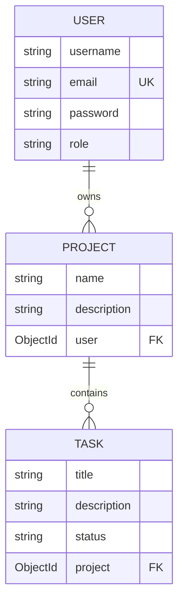
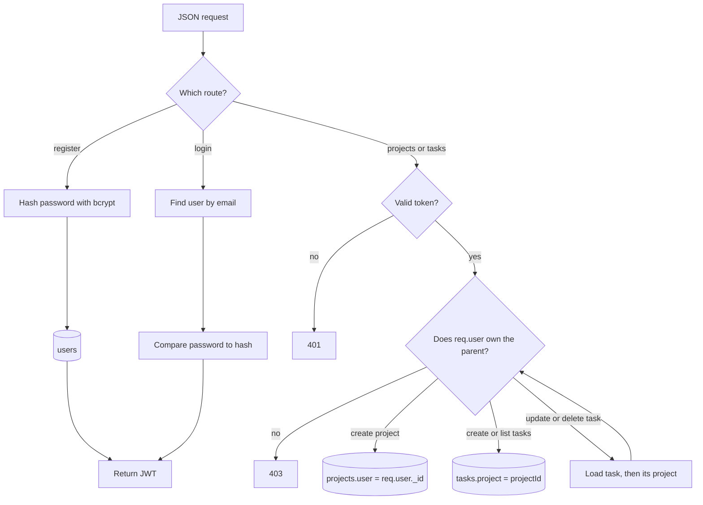
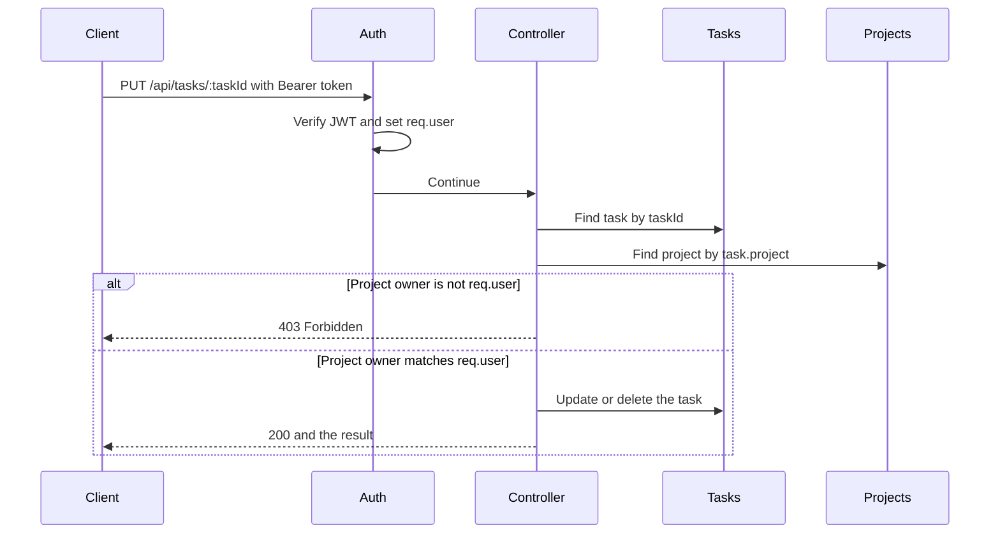

# TaskMaster API

Backend for TaskMaster, a productivity app that manages user accounts, projects, and tasks. The API uses Express, MongoDB, and JWT authentication. Every project and task route checks that the logged-in user owns the data.

## Project structure

```
server.js                 Entry point: loads env, connects to MongoDB, mounts routes
config/connection.js      Mongoose connection using MONGO_URI
models/index.js           Exports User, Project, and Task
models/User.js            User schema, password hash, password check
models/Project.js         Project schema with a reference to its owner
models/Task.js            Task schema with a reference to its project
routes/index.js           Mounts /api and the 404 handler
routes/api/index.js       Splits /users, /projects, and /tasks
routes/api/userRoutes.js  Register and login
routes/api/projectRoutes.js  Project CRUD and nested task create/list
routes/api/taskRoutes.js  Update and delete a single task
controllers/userController.js
controllers/projectController.js
controllers/taskController.js
utils/auth.js             Signs JWTs and checks the Authorization header
```

Routes only match a URL and call a controller. Controllers talk to the models. `utils/auth.js` sits in front of every project and task route.

## Workflow

1. `npm start` runs `server.js`. It loads `.env`, opens the MongoDB connection, and listens on `PORT`.
2. A request hits `routes/index.js`, which forwards anything under `/api` to `routes/api/index.js`. Unknown paths return `404`.
3. `routes/api/index.js` sends the request to the user, project, or task router.
4. **Register.** `POST /api/users/register` creates a user. The User model's `pre-save` hook hashes the password with bcrypt, then `signToken` returns a JWT.
5. **Login.** `POST /api/users/login` finds the user by email, compares the password with `isCorrectPassword`, and returns a JWT when the password matches.
6. **Protected routes.** Project and task routers run `authMiddleware` first. It reads `Authorization: Bearer <token>`, verifies the token with `JWT_SECRET`, and sets `req.user`. A missing or invalid token returns `401`.
7. **Projects.** The controller saves `req.user._id` as the project's `user`. List, read, update, and delete only succeed when that field matches the logged-in user. Another user's project returns `403`.
8. **Tasks.** Create and list load the project in `:projectId` and require that the logged-in user owns it. Update and delete load the task, then its parent project, and apply the same ownership check. A failed check returns `403`. A missing project or task returns `404`.

## Data workflow

A user owns many projects. A project contains many tasks. The link is stored as an id, not a nested document.



Registration writes a user. Login only reads that user and returns a token. Project and task writes happen after the token is checked.



Updating or deleting a task is the longest path, because the task document does not store the owner. The owner lives on the parent project.



## Setup

1. Install dependencies:

```bash
npm install
```

2. Create a `.env` file in the project root:

```
MONGO_URI=your_mongodb_connection_string
PORT=3000
JWT_SECRET=your_secret
```

`.env` is listed in `.gitignore` and must not be committed.

3. Start the server:

```bash
npm start
```

The examples below use `http://localhost:3000`. Send JSON bodies with the header `Content-Type: application/json`. Protected routes also need `Authorization: Bearer <token>`.

## API

### Users

| Method | Path | Auth | Description |
| --- | --- | --- | --- |
| POST | `/api/users/register` | No | Create a user and return a token |
| POST | `/api/users/login` | No | Check email and password, then return a token |

Register body:

```json
{
  "username": "usera",
  "email": "usera@test.com",
  "password": "secret1"
}
```

Login body:

```json
{
  "email": "usera@test.com",
  "password": "secret1"
}
```

Passwords are hashed with bcrypt before they are saved. A successful register or login returns `{ "token": "...", "user": { ... } }`.

### Projects

All project routes require a valid token. The owner is taken from the token, not from the request body.

| Method | Path | Description |
| --- | --- | --- |
| POST | `/api/projects` | Create a project for the logged-in user |
| GET | `/api/projects` | List projects owned by the logged-in user |
| GET | `/api/projects/:id` | Get one project the user owns |
| PUT | `/api/projects/:id` | Update a project the user owns |
| DELETE | `/api/projects/:id` | Delete a project the user owns |

Create body:

```json
{
  "name": "Alpha",
  "description": "First project"
}
```

### Tasks

Creating and listing tasks requires ownership of the parent project. Updating and deleting a task finds that task, loads its project, and checks that the logged-in user owns the project.

| Method | Path | Description |
| --- | --- | --- |
| POST | `/api/projects/:projectId/tasks` | Create a task on a project the user owns |
| GET | `/api/projects/:projectId/tasks` | List tasks for a project the user owns |
| PUT | `/api/tasks/:taskId` | Update a task on a project the user owns |
| DELETE | `/api/tasks/:taskId` | Delete a task on a project the user owns |

Create body:

```json
{
  "title": "Write tests",
  "description": "Cover CRUD",
  "status": "pending"
}
```

`status` must be `pending`, `in progress`, or `complete`. It defaults to `pending`.

## Test cases

Use two accounts so the ownership checks can be verified. Call them User A and User B.

### 1. Register User A

- **Request:** `POST /api/users/register`
- **Body:** `{ "username": "usera", "email": "usera@test.com", "password": "secret1" }`
- **Expect:** `201` and a `token`

### 2. Register User B

- **Request:** `POST /api/users/register`
- **Body:** `{ "username": "userb", "email": "userb@test.com", "password": "secret2" }`
- **Expect:** `201` and a different `token`

### 3. Log in

- **Request:** `POST /api/users/login`
- **Body:** `{ "email": "usera@test.com", "password": "secret1" }`
- **Expect:** `200` and a token
- **Wrong password:** `400`

### 4. Reject a protected route with no token

- **Request:** `GET /api/projects` with no `Authorization` header
- **Expect:** `401`

### 5. User A creates a project

- **Request:** `POST /api/projects` with User A's token
- **Body:** `{ "name": "Alpha", "description": "First project" }`
- **Expect:** `201`. Save the returned `_id` as `projectId`. The `user` field matches User A.

### 6. Each user sees only their own projects

- **Request:** `GET /api/projects` with User A's token
- **Expect:** `200` and a list that includes Alpha
- **Request:** `GET /api/projects` with User B's token
- **Expect:** `200` and an empty list

### 7. User B cannot read, update, or delete User A's project

- **Request:** `GET /api/projects/:projectId` with User B's token
- **Expect:** `403`
- **Request:** `PUT /api/projects/:projectId` with User B's token and `{ "name": "Hijack", "description": "nope" }`
- **Expect:** `403`
- **Request:** `DELETE /api/projects/:projectId` with User B's token
- **Expect:** `403`

### 8. User A updates their project

- **Request:** `PUT /api/projects/:projectId` with User A's token
- **Body:** `{ "name": "Alpha Updated", "description": "Still mine" }`
- **Expect:** `200` and the updated name

### 9. User A creates a task

- **Request:** `POST /api/projects/:projectId/tasks` with User A's token
- **Body:** `{ "title": "Write tests", "description": "Cover CRUD", "status": "pending" }`
- **Expect:** `201`. Save the returned `_id` as `taskId`.

### 10. User B cannot list, update, or delete that task

- **Request:** `GET /api/projects/:projectId/tasks` with User B's token
- **Expect:** `403`
- **Request:** `PUT /api/tasks/:taskId` with User B's token and `{ "title": "Stolen", "description": "nope", "status": "complete" }`
- **Expect:** `403`
- **Request:** `DELETE /api/tasks/:taskId` with User B's token
- **Expect:** `403`

### 11. User A updates and deletes the task

- **Request:** `PUT /api/tasks/:taskId` with User A's token and `{ "title": "Write tests", "description": "Cover CRUD", "status": "in progress" }`
- **Expect:** `200` and `"status": "in progress"`
- **Request:** `DELETE /api/tasks/:taskId` with User A's token
- **Expect:** `200` and `{ "message": "Task deleted!" }`

### 12. User A deletes the project

- **Request:** `DELETE /api/projects/:projectId` with User A's token
- **Expect:** `200` and `{ "message": "Project deleted!" }`

### 13. Missing records

- **Request:** `GET /api/projects/<unknown id>` with a valid token
- **Expect:** `404`
- **Request:** `PUT /api/tasks/<unknown id>` with a valid token
- **Expect:** `404`
