# TaskMaster API

An Express and Mongoose API for user accounts, projects, and tasks. It does not serve an HTML page.

## Description

The server reads `PORT`, `MONGO_URI`, and `JWT_SECRET` from the environment. `server.js` uses `PORT` or `3001`. This run printed `injected env (3) from .env` and `App is listening on localhost:3000`.

`npm run dev` starts the same file with nodemon.

A user has a username, email, password, and role. A project has a name, description, and the id of its owner. A task has a title, description, status, and the id of its project.

`POST /api/users/register` creates a user and returns 201 with a token and the user document. The password is hashed with bcrypt before it is saved, and the response still includes that hash. The token payload is the username, email, and `_id`. It expires in 2 hours. The role is not in the token.

This account was created with username `maya_tasks`, email `maya.tasks@example.com`, and password `coffee123`. The role was left out, so it came back as `user`.

`POST /api/users/login` finds the user by email. A match returns 200 with a new token and the same user document, including the hash. Login puts `_id` first in the user object.

Sending `"role": "admin"` on register stores that role. The account `ada_tasks` / `ada.tasks@example.com` came back with `"role": "admin"`. A third account, `leo_tasks` / `leo.tasks@example.com`, was created with the default role `user`. Those three accounts are still in the database. There is no route that deletes a user.

A password shorter than 5 characters is rejected with 400. The error repeats the submitted password. This request used `tiny`.

An email that does not match `/.+@.+\..+/` is rejected with 400 and the message `Must use a valid email address`. This request used `not-an-email`.

A duplicate username returns 400 with a Mongo `E11000` error on `Project_BD.users` index `username_1`.

A duplicate email returns the same kind of 400, on index `email_1`. Registering `email_dup_tasks` with `maya.tasks@example.com` produced `E11000 duplicate key error collection: Project_BD.users index: email_1`.

A wrong password returns 400 and `{ "message": "Wrong password!" }`.

An unknown email returns 400 and `{ "message": "Can't find this user" }`.

Every project route and every task route runs the auth middleware first. It reads a token from the JSON body, the query string, or the `Authorization` header. When the header is present, it uses the last space-separated piece. A request with no token returns 401.

A token that does not verify returns 401 and `{ "message": "Invalid token." }`. The server also prints `Invalid token`.

A query token is enough. `GET /api/projects?token=...` with Maya's token returned 200 and her project list.

`POST /api/projects` saves the name and description and sets `user` to the logged-in user's id. This body also sent `"user": "000000000000000000000000"`. The saved project belongs to Maya, `6acfcbf14120d03a71274f93`.

`GET /api/projects` returns only that user's projects. Maya's list had this project. Leo's list was `[]`.

`GET /api/projects/:id` returns the project when the logged-in user owns it. Leo's token on Maya's project returned 403.

Leo's update returned 403 and `{ "message": "User is not authorized to update this project." }`. Leo's delete returned 403 and `{ "message": "User is not authorized to delete this project." }`.

Maya's update renamed the project to `Alpha Updated` and set the description to `Still mine`. The body also sent a different `user` id. That field was removed before the update, so the owner stayed Maya. `createdAt` stayed `2026-10-14T18:38:39.969Z` and `updatedAt` moved to `2026-10-14T18:40:12.543Z`. Both updates logged Mongoose's warning that the `new` option on `findOneAndUpdate()` is deprecated.

A create that omits name and description returns 400. The message is "Project validation failed: description: Path `description` is required., name: Path `name` is required."

A real id that is not in the collection returns 404 and `{ "message": "No project found with this id!" }`.

`not-an-id` is not an ObjectId, so the get returns 500 and a `CastError`.

`DELETE /api/projects/:id` returns 200 and `{ "message": "Project deleted!" }` when the owner asks for it. The handler deletes that project document. After this delete, Maya's project list was `[]`.

`POST /api/projects/:projectId/tasks` checks that the project exists and that the logged-in user owns it, then saves the task on that project. This body sent `"project": "000000000000000000000000"` and `"status": "pending"`. The saved task uses the id from the URL. Status defaults to `pending` when it is left out. The allowed values are `pending`, `in progress`, and `complete`.

Leo's create on Maya's project returned 403 and `{ "message": "User is not authorized to create a task for this project." }`. Leo's task list returned 403 and `{ "message": "User is not authorized to view tasks for this project." }`.

`GET /api/projects/:projectId/tasks` returns the tasks for that project. After the update below, the list had one task with status `in progress`.

`PUT /api/tasks/:taskId` updates the task when the logged-in user owns the parent project. This update set the status to `in progress` and also sent a different `project` id. That field was removed before the update, so the task stayed on `6acfcc2f4120d03a71274f99`. `updatedAt` moved to `2026-10-14T18:41:19.927Z`.

Leo's update returned 403 and `{ "message": "User is not authorized to update this task." }`. Leo's delete returned 403 and `{ "message": "User is not authorized to delete this task." }`.

A status of `done` is rejected on create. The 400 body says "`done` is not a valid enum value for path `status`" and lists `pending`, `in progress`, and `complete`.

Creating a task for `000000000000000000000000` returns 404 and `{ "message": "No project found with this id!" }`. Updating `000000000000000000000000` as a task id returns 404 and `{ "message": "No task found with this id!" }`.

`DELETE /api/tasks/:taskId` returns 200 and `{ "message": "Task deleted!" }` for the owner.

There is no route that reads one task. `GET /api/tasks/:taskId` falls through to the 404 handler.

`GET /` and `GET /api/register` return 404. The body is the heading `😝 404 Error!`. The page does not set a background.

## Screenshots

### Accounts

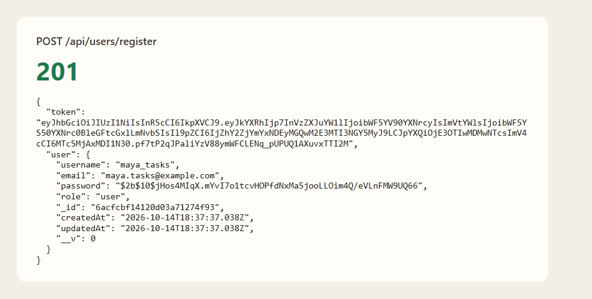

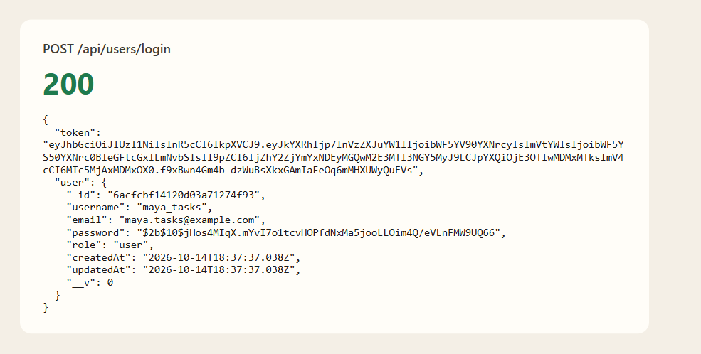

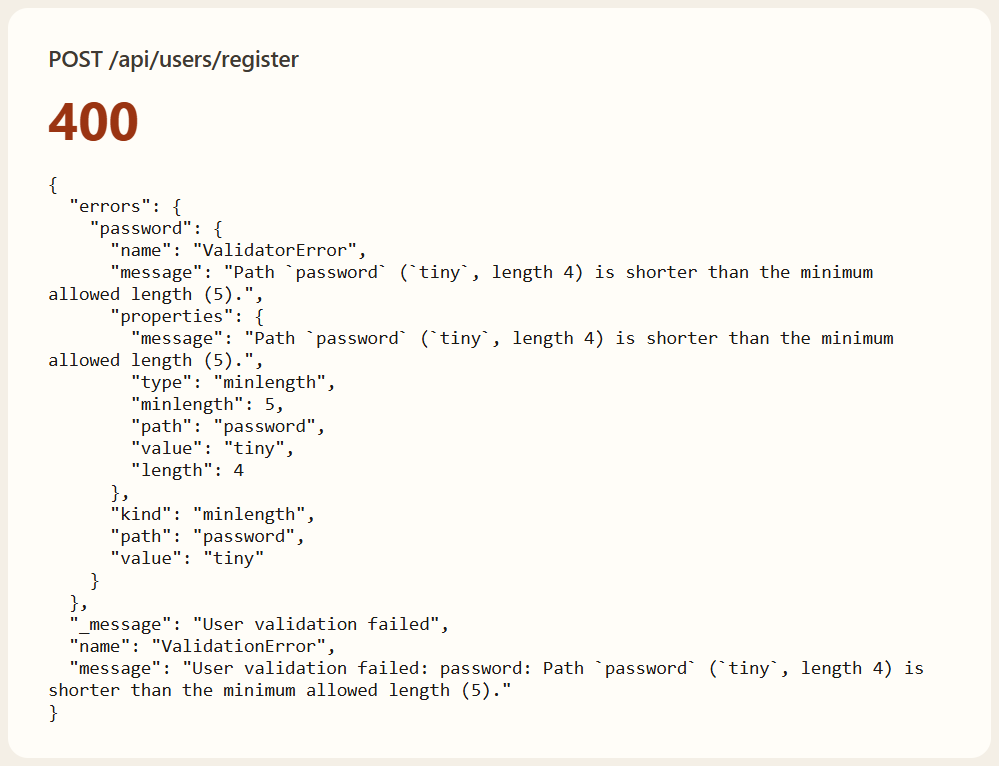

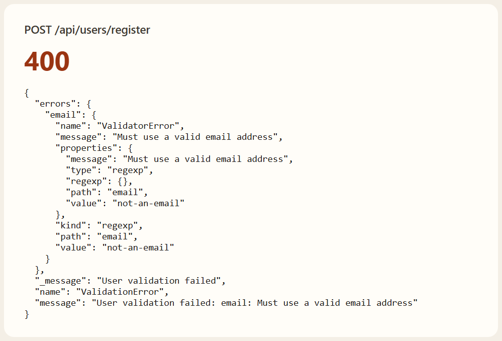

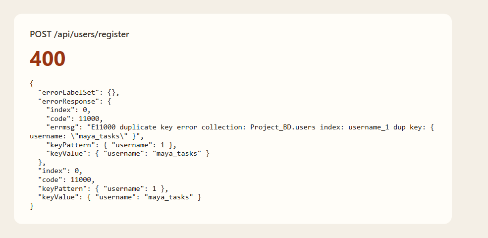

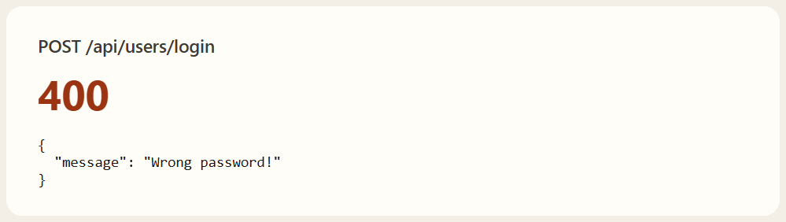

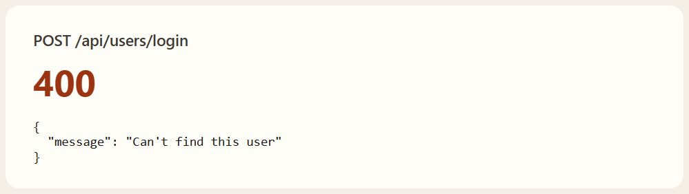

### Projects

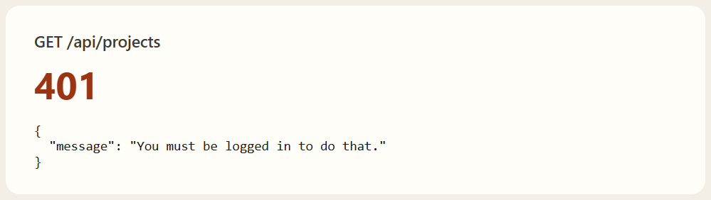

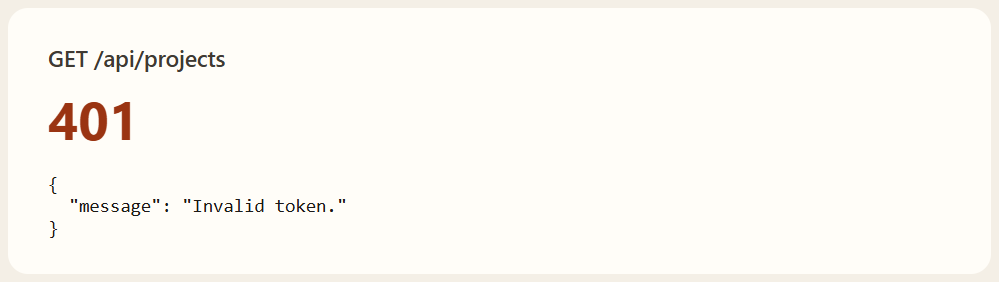

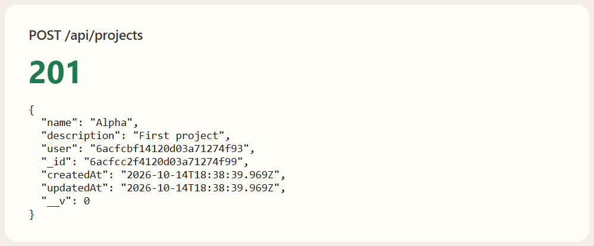

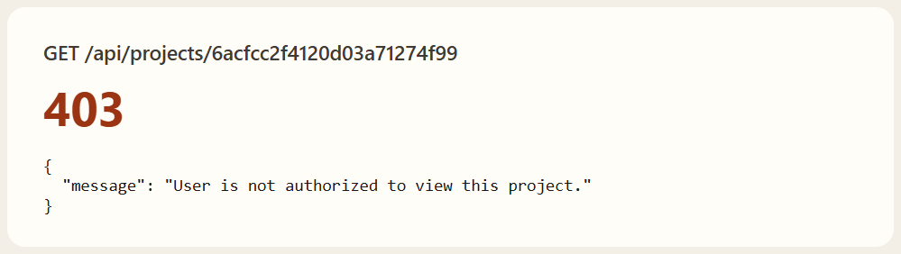

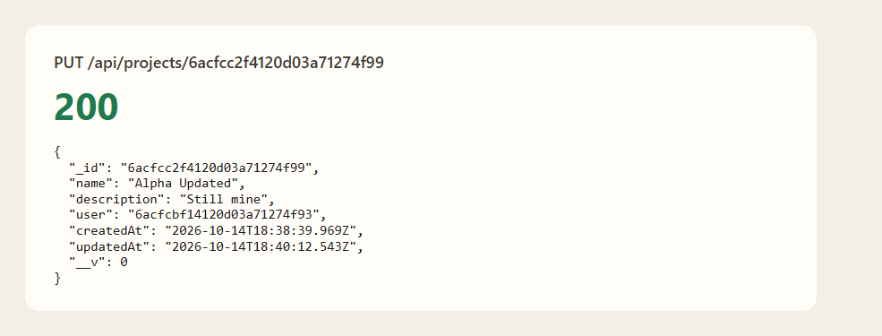

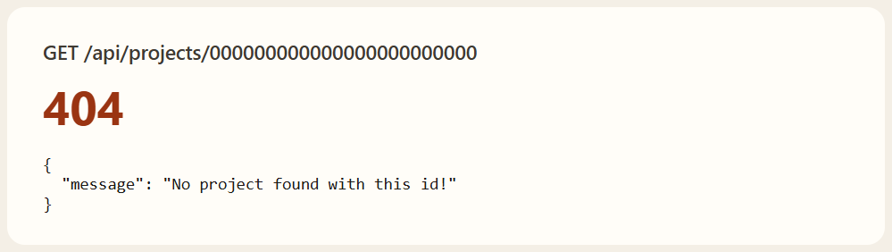

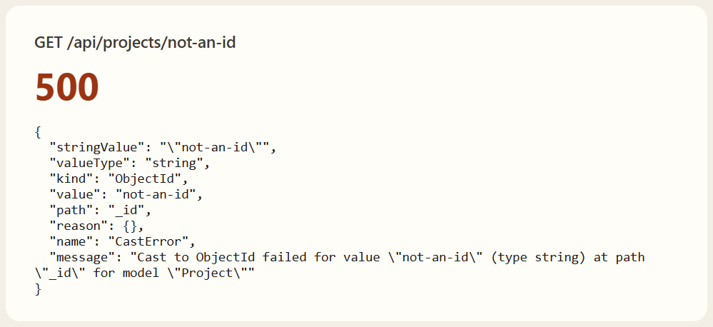

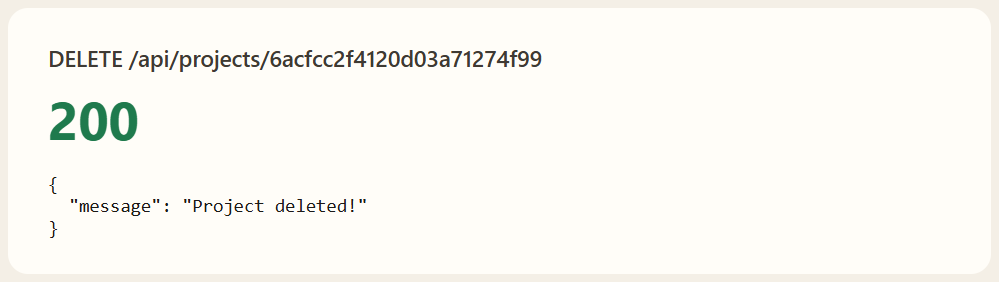

### Tasks

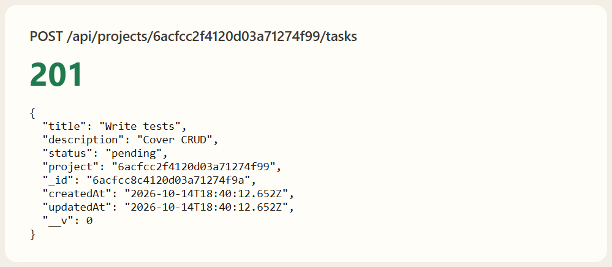

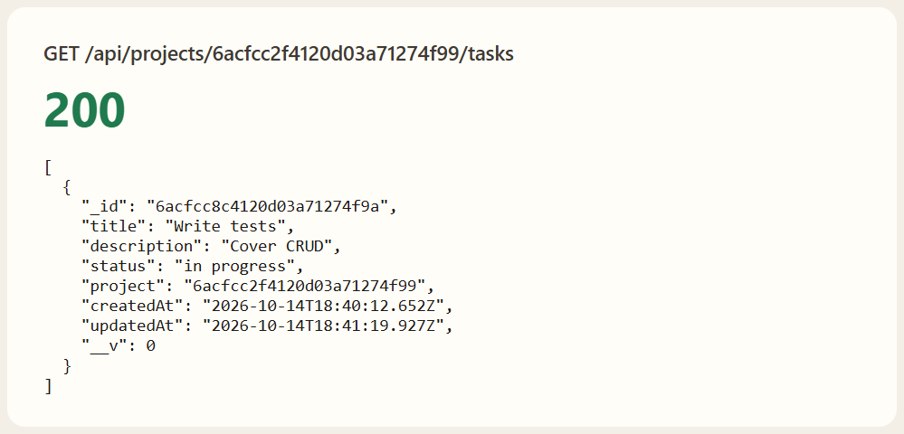

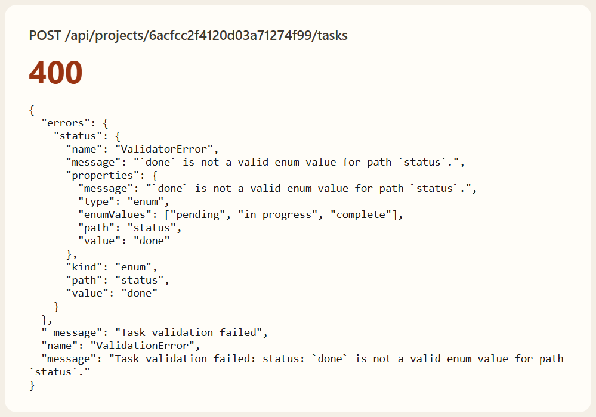

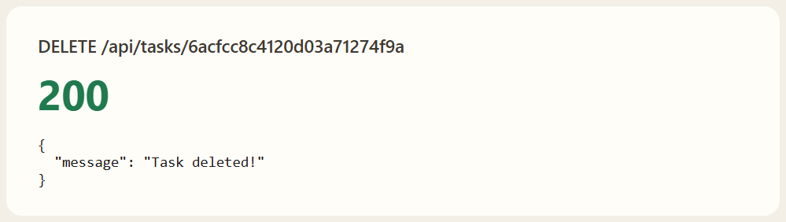

### Unknown paths


## Getting Started

### Dependencies

* Node.js and npm
* MongoDB
* `PORT`, `MONGO_URI`, and `JWT_SECRET`

### Installing

```bash
npm install
```

### Executing program

```bash
npm start
```

This run printed `App is listening on localhost:3000`. `server.js` uses `PORT` or `3001`. `npm run dev` starts the same file with nodemon.

## Help

There is no route that deletes a user. A short password error repeats the submitted password. Register and login responses include the bcrypt hash. A missing token returns 401. A token that does not verify returns `{ "message": "Invalid token." }`. `not-an-id` on a project returns 500 and a `CastError`. A status of `done` returns 400. `GET /` and `GET /api/register` return the heading `😝 404 Error!`.

## Authors

[Mamadou Moussa Balde](https://www.linkedin.com/in/2mb/)

## Version History

* Current local run
    * Listened at http://localhost:3000
    * Accounts `maya_tasks`, `ada_tasks`, and `leo_tasks` were created
    * Project Alpha was created on 2026-10-14, updated, and deleted

## License

This folder does not include a `LICENSE.md` file.

## Acknowledgments

* [README template](https://gist.github.com/DomPizzie/7a5ff55ffa9081f2de27c315f5018afc)
